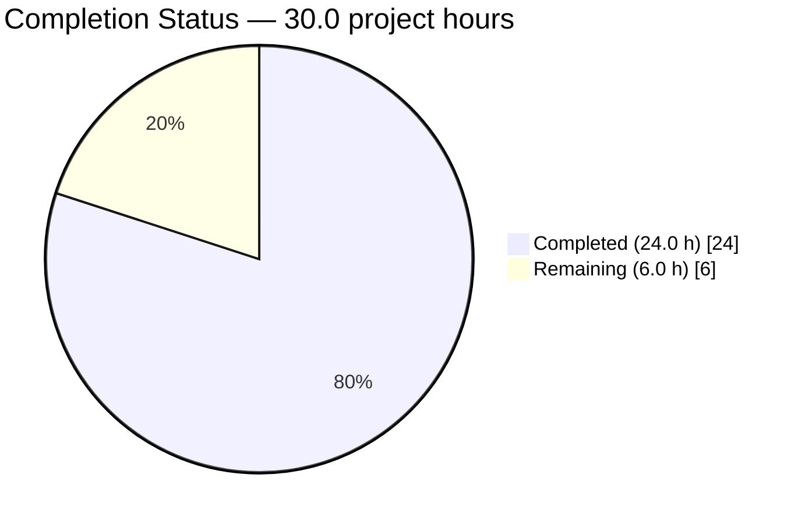
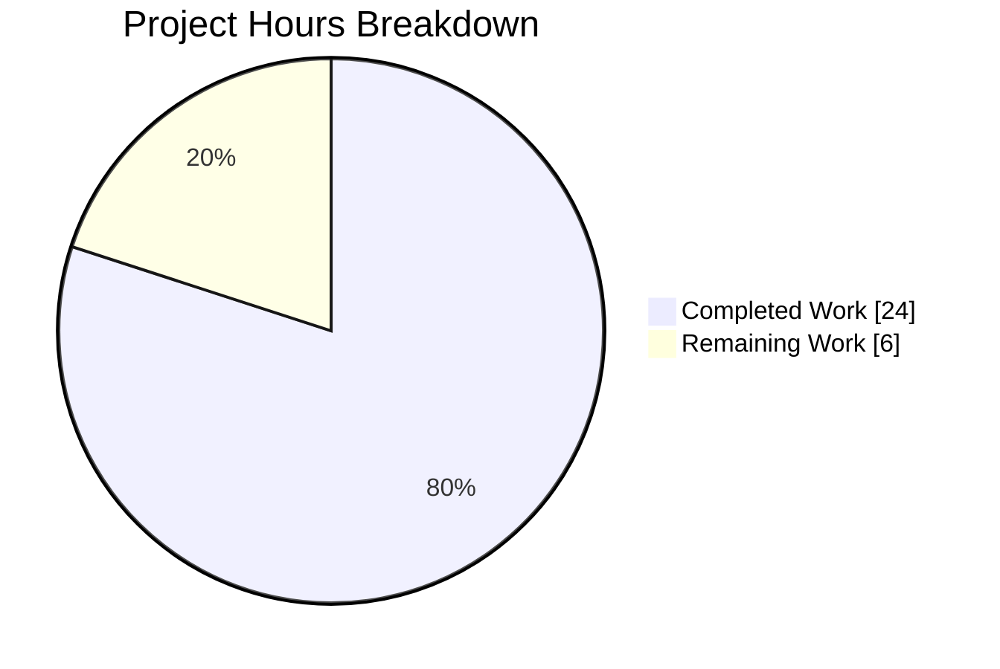
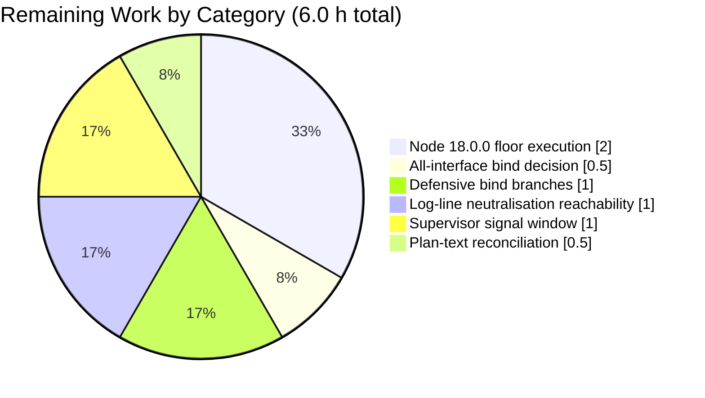

# 1. Executive Summary

## 1.1 Project Overview

A three-file, dependency-free Node.js HTTP server built on the built-in `http` module. It answers `GET /hello` with `200 Hello world`, answers every other method and path with `404 Not Found`, logs each request in a fixed format, refuses an unusable `PORT` with one actionable message, and shuts down cleanly on `SIGINT`. It exists to teach: the code, the console output and the README are reproducible byte for byte by a reader new to Node.

## 1.2 Completion Status



**80% complete** — 24.0 hours of a 30.0-hour scope (`24.0 / (24.0 + 6.0) × 100`). All 44 requirements are implemented and verified; the 6.0 remaining hours are path-to-production validation and decisions, itemised in Section 2.2.

| Metric | Hours |
|---|---|
| **Total Hours** | **30.0** |
| **Completed Hours** (Baseline: Human with agentic-assist) | **24.0** |
| **Remaining Hours** | **6.0** |

## 1.3 Key Accomplishments

- ✅ Both outcomes byte-exact: `200` / `Hello world` / 11 bytes and `404` / `Not Found` / 9 bytes, no `Allow` header, no third status.
- ✅ Exact-match dispatch: `/hello?x=1` is `200`; `/hello/`, `/Hello`, `HEAD` and `POST /hello` are `404`.
- ✅ One fixed-format request line per request, written before dispatch, query string dropped.
- ✅ `PORT` defaults to `3000` only when absent, accepts `1024`–`65535`, and refuses ten invalid forms with exit `1`.
- ✅ Bind failures announced in one stderr sentence with exit `1`, no stack trace, no false startup line.
- ✅ `SIGINT` prints the shutdown line, destroys tracked sockets, exits `0`, releases the port.
- ✅ Measured: p95 0.274 ms, max 0.771 ms, 100 of 100 concurrent requests answered, RSS flat after warm-up.
- ✅ `README.md` reproduces end to end on a machine with Node.js and `curl` alone.

## 1.4 Critical Unresolved Issues

Six follow-ups remain open across the 44 requirements; each is a validation or a decision, not unimplemented functionality.

| Issue | Impact | Owner | ETA |
|---|---|---|---|
| Node.js 18.0.0 — the declared floor — has never been executed; the floor is proven by API-surface enumeration on v22.23.5 only | A floor-level incompatibility would surface as a runtime failure on the oldest supported release | Release engineering | 2.0 h |
| The `EACCES` and generic-bind messages are implemented but no documented route reaches them, so they have never been emitted end to end | An unexpected bind failure's wording is unproven on the wire | QA | 1.0 h |
| The C0/DEL neutralisation of the request log line cannot be reached over HTTP on this runtime, so no gate exercises it | If a runtime ever admitted a raw control byte, an operator's terminal would be the first place it showed | Security review | 1.0 h |
| A `SIGINT` inside the sub-millisecond bind-failure window is proven only with an artificial event-loop hold | A supervisor could observe the exit status under a stop-during-start race | Operations | 1.0 h |
| The port binds every interface with no authentication, TLS, security header or rate limiting; the README discloses this but no firewall or hosting guidance exists | Both routes are reachable from the local network on a shared host | Platform owner | 0.5 h |
| No automated regression net exists — no test file, runner, script or CI — and Node 18 reached end-of-life on 2025-03-27 | Future edits rely on the manual gate set, and the declared floor is ageing out | Maintainer | 0.5 h |

## 1.5 Access Issues

No access issues identified: zero dependencies, no credentials, no external service and no environment file; every command runs from the repository root with `node`, `npm`, `curl` and a POSIX shell.

## 1.6 Recommended Next Steps

1. **[High]** Run the full verification set on Node.js 18.0.0 and record latency, concurrency, memory and every exit status there.
2. **[High]** Decide the deployment posture for the all-interface bind — firewall the port or scope the listener — and write it into `README.md` §1.
3. **[Medium]** Evidence the two defensive bind branches and the log-line neutralisation against paths that reach them; record anything that stays ungated.
4. **[Medium]** Validate the bind-failure-plus-`SIGINT` window under the supervisor that will actually run the process.
5. **[Low]** Reconcile the plan text with the recorded divergences, and schedule the runtime-floor review.

# 2. Project Hours Breakdown

## 2.1 Completed Work Detail

| Component | Hours | Description |
|---|---|---|
| Request pipeline | 6.5 | Module constants; `resolvePort` validation with `Number()` and an inclusive `1024`–`65535` range; `parsePath` with the guarded `new URL` conversion and raw-target fallback; `logRequest`'s three-field ISO-8601 line; `sendText` as the single response writer with an explicit `Content-Length`; the two route handlers; `routeRequest` dispatching parse → log → match on method and pathname (`server.js:1-95`). Covers FR-1..FR-4 and IM-1..IM-3. |
| Process lifecycle | 4.0 | `createServer` with the `'connection'` listener that tracks and releases sockets; the listen callback that prints the startup line only after a successful bind; `attachListenErrorHandler`'s `EADDRINUSE` / `EACCES` / generic branches, each one stderr sentence and exit status `1`; `attachShutdownHandler`'s `process.once('SIGINT')`, `server.listening` guard, socket destruction and non-masking exit status; `main` as the single place `process.env.PORT` is read (`server.js:97-174`). Covers FR-5..FR-7, B-1, B-5..B-9. |
| Manifest | 1.0 | `package.json` with exactly the seven required fields in order — `name`, `version`, `description`, `main`, `scripts.start`, `engines.node`, `keywords` — no dependency keys, no `type`, no `test` script. Covers V-15 and the zero-dependency mandate. |
| README execution guide | 4.5 | Eight numbered sections: purpose with the all-interface exposure disclosure, prerequisites (Node.js `>=18.0.0`, `curl`, a POSIX shell), installation (none), running (`node server.js` and `npm start` with npm's banner), testing by hand (three curl exchanges plus the latency and concurrency clients), expected output, configuration (default, range, ten invalid forms, occupied port), shutdown (`CTRL+C`, the shutdown line, `echo $?`, npm's `130`). Covers FR-8, §0.6.2 and V-18. |
| Command-level evidence set | 4.5 | The 18-gate verification set executed end to end — startup line, all three curl exchanges with header and byte checks, the request-log format, `SIGINT` exit status, latency with 20 discarded warm-ups, 100 parallel requests, RSS across repeated rounds, `PORT` override, ten invalid forms, occupied port, `npm start`, manifest metadata, the security grep, the tree shape and the README walkthrough. Covers §0.9.3 and NFR-1..NFR-3. |
| Security boundaries and exposure disclosure | 3.5 | Verification that no dynamic evaluation, filesystem access, child process or outbound client exists; that no handler reads a header, query string or body; that both response bodies are compile-time constants; that no internal detail reaches an HTTP response; and the README §1 paragraph disclosing the host-less bind and the absence of authentication, TLS, security headers and rate limiting. Covers NFR-4, V-16 and §0.12.2. |
| **Total** | **24.0** | Completed work, all of it traceable to a requirement of the plan. |

## 2.2 Remaining Work Detail

| Category | Hours | Priority |
|---|---|---|
| Execute the verification set on Node.js 18.0.0, the declared floor: install 18.x, repeat every gate, record p95/max, concurrency, RSS and each exit status | 2.0 | High |
| Decide the deployment posture for the all-interface bind — firewall the port, or scope the listener to one host — and record it in `README.md` §1 and the deployment note | 0.5 | High |
| Decide and evidence the two defensive bind branches (`EACCES`, generic): provoke them through a real path, or record them as accepted-ungated | 1.0 | Medium |
| Prove the log-line control-character neutralisation against a reachable input path (a reverse proxy, or a runtime that admits raw control bytes in the request target) | 1.0 | Medium |
| Validate the bind-failure-plus-`SIGINT` window under the process supervisor that will run the service, confirming a failed start's exit status `1` survives | 1.0 | Medium |
| Reconcile the plan text with the delivered behaviour for the recorded divergences, and schedule the runtime-floor review for Node 18's end-of-life | 0.5 | Low |
| **Total** | **6.0** | |

# 3. Test Results

The deliverable carries no test runner, test file or coverage configuration: `node --test` reports `tests 0 / pass 0 / fail 0`, and the plan fixes the artifact set at three files. The covering suite is therefore the command-level verification set, `V-1` … `V-18` of the plan, executed end to end on this checkout. Every figure below was observed in that run: **131 assertions, 131 passed, 0 failed**.

| Area / Category | Framework | Tests | Passed | Failed | Coverage | What This Proves |
|---|---|---|---|---|---|---|
| Build, manifest and tree integrity | `node --check`, `node -e` readers, `git ls-files` | 14 | 14 | 0 | n/a — no coverage tooling | The three files parse, the manifest is exactly the seven required fields with no dependency keys, all eleven components exist in order, and the tree holds no fourth artifact. |
| HTTP contract: routes, methods, framing, byte fidelity | `curl`, raw `net.Socket` | 27 | 27 | 0 | n/a — no coverage tooling | Both outcomes are byte-exact and every other method-and-path combination — including `POST /hello`, `/hello/`, `/Hello`, `HEAD` and a malformed target — reaches the same 404 with no `Allow` header. |
| Console contract and graceful shutdown | shell, `SIGINT`, `wc -c` | 8 | 8 | 0 | n/a — no coverage tooling | One startup line, one fixed-format log line per request with the query string dropped, one shutdown line, empty stderr and exit status `0` with the port released. |
| Port configuration and validation | shell, `PORT` matrix | 41 | 41 | 0 | n/a — no coverage tooling | The default applies only when `PORT` is absent, an override binds only the named port, `1024` and `65535` are accepted, and ten invalid forms each exit `1` with `Invalid PORT "<value>": PORT must be an integer between 1024 and 65535.` and no startup line. |
| Bind-failure handling | two concurrent processes | 8 | 8 | 0 | n/a — no coverage tooling | An occupied port yields one stderr sentence naming the port, exit `1`, no stack trace, nothing on stdout, and the holding server still shuts down cleanly. |
| Latency, concurrency and memory | Node.js clients, `/proc/<pid>/status` | 4 | 4 | 0 | n/a — no coverage tooling | `/hello` costs p95 0.274 ms and at worst 0.771 ms over 200 measured round trips, 100 parallel requests all return `200` with no errors, and RSS settles at 60.3 → 62.3 MB across three 1000-request rounds. |
| npm entry point | `npm start` | 8 | 8 | 0 | n/a — no coverage tooling | `npm start` runs the identical server after npm's banner, prints the startup line, answers `200`, and creates no lockfile and no `node_modules`. |
| README reproducibility | `bash -n`, literal matching | 21 | 21 | 0 | n/a — no coverage tooling | The eight sections are present in order, every quoted literal matches what the code emits, and all 15 bash command lines parse. |

**Not Covered** — capabilities that are delivered but that no test exercises, and what a human should verify before release:

- **The `EACCES` and generic-bind messages.** The `1024` floor refuses a privileged port before any bind is attempted, so no documented route reaches either branch; only reading the code confirms their wording (`server.js:118-127`). Verify by provoking a real permission failure or an unexpected bind error, or accept them as defensive and record that decision.
- **The C0/DEL neutralisation of the request log line** (`server.js:17`, `:51-58`). Node's HTTP parser answers `400` to a request line carrying a raw control byte and `new URL` percent-encodes one in a parseable target, so no request that reaches the listener can carry one; the escaping is exercised only by calling `logRequest` directly. Verify behind a proxy or on a runtime that admits raw control bytes.
- **A `SIGINT` arriving inside the bind-failure window.** The window is sub-millisecond and is reachable only by holding the event loop open artificially, so the exit-status preservation is defended and reasoned but not gate-covered. Verify under the supervisor that will actually run the process.
- **Node.js 18.0.0 itself.** The floor is proven by API-surface enumeration — no `closeIdleConnections`, `closeAllConnections`, `fetch` or other post-18.0.0 API is used — and not by execution; every figure in this section was measured on v22.23.5.
- **`npm start`'s shell status.** The documented `130` requires an interrupt delivered to npm's process group, as a terminal `CTRL+C` does; a harness signalling only the child sees npm propagate the server's `0`.
- **Prose claims in `README.md`.** Sentences cannot be asserted directly; each was exercised by running the commands the sentence describes and comparing the printed output.
- **Machine dependence.** The latency, concurrency and memory figures are thresholds met on this host, not constants: any re-run should assert p95 and maximum below 10 ms, 100 of 100 answered, and no sustained RSS trend.

# 4. Runtime Validation &amp; UI Verification

There is no rendered interface to verify: both responses are fixed `text/plain` bodies, so every runtime observation below is process stdout/stderr, an HTTP exchange, an exit status or TCP state.

- ✅ **Process start** — `node server.js` prints `Server listening on port <PORT>` exactly once, from the listen callback, so a failed bind prints no startup line (`server.js:170`).
- ✅ **`GET /hello`** — `HTTP/1.1 200 OK`, `Content-Type: text/plain`, `Content-Length: 11`, an 11-byte `Hello world` body, no chunked encoding; identical through `curl` and through a Node client.
- ✅ **404 catch-all** — `/invalid`, `POST /hello`, `/hello/`, `/Hello`, `HEAD`, `OPTIONS` and `DELETE` all answer `HTTP/1.1 404 Not Found` with a 9-byte `Not Found` body and no `Allow` header.
- ✅ **Exact-match semantics** — `/hello?x=1` answers `200` because the query string is outside the matched pathname; the trailing slash is inside it, so `/hello/` answers `404`.
- ✅ **Request logging** — one line per request written before dispatch: `2026-11-26T02:50:04.912Z POST /hello`; the query string never appears, and a target `new URL` rejects (`//[bad`) is logged verbatim and answered `404` with the process alive.
- ✅ **Port configuration** — absent `PORT` binds `3000`; `PORT=8080` binds only `8080`; `1024` and `65535` are accepted; `abc`, `80`, `70000`, `3000.5`, an empty value, `1023`, `65536`, `1e3`, `-1` and a single space each exit `1` with one stderr sentence and no startup line.
- ✅ **`SIGINT` shutdown** — the shutdown line prints once, tracked sockets are destroyed, the keep-alive wait never happens, the port is released and the process exits `0`.
- ✅ **`npm start`** — npm's banner, then the startup line, then a `200`, then the shutdown line on interrupt; no lockfile or `node_modules` appears afterwards.
- ⚠ **Runtime-level request handling** — a request line carrying an invalid method token or a raw control byte is answered `400` by Node's own parser before the request listener runs, and `CONNECT`/`Upgrade` are handled by the runtime rather than by either route; the product defines two outcomes and presents no third.
- ⚠ **External integration** — there is none to drive: the server opens no outbound connection, reads no file, holds no credential, contacts no service and stores nothing, so this line records an absence rather than a failure.

**Never exercised at runtime:** the `EACCES` and generic-bind branches (no documented route reaches them, because the `1024` floor refuses a privileged port before any bind is attempted); the C0/DEL log-line escaping (no request that reaches the listener can carry a raw control byte on this runtime); a `SIGINT` delivered inside the bind-failure window (reachable only by holding the event loop open); the declared Node.js 18.0.0 floor (never installed — every observation here is on v22.23.5); `npm start`'s shell status `130` (needs a terminal-style process-group interrupt); and `SIGTERM`, `SIGHUP` and `SIGQUIT`, which the contract deliberately leaves unhandled.

# 5. Compliance &amp; Quality Review

## 5.1 Compliance Matrix

| Deliverable | Benchmark | Status | Progress | Evidence |
|---|---|---|---|---|
| HTTP outcome literals | Plan §0.9.1 contract table, FR-2/FR-3 | ✅ PASS | 100% | Byte-exact status line, `Content-Type`, `Content-Length` 11/9 and both bodies on the wire; no `Allow` header |
| Dispatch semantics | IM-1, IM-2, B-12 | ✅ PASS | 100% | Exact method-and-pathname match; query outside the match, trailing slash inside it; malformed target answered `404` without a crash |
| Request logging | FR-4, V-5, B-2, NFR-6 | ✅ PASS | 100% | 3,334 log lines, all three-field ISO-8601, query dropped, written before dispatch |
| Port configuration and refusal | FR-1, FR-7, B-3, B-4 | ✅ PASS | 100% | Default only when absent; inclusive `1024`–`65535`; ten invalid forms exit `1` with one message shape |
| Bind-failure reporting | FR-7, B-9, V-13 | ✅ PASS | 100% | `EADDRINUSE` byte-exact with exit `1`, no stack trace; `EACCES` and generic branches implemented per §0.9.1's defensive design |
| Graceful shutdown | FR-6, B-5, B-6, B-7 | ✅ PASS | 100% | One shutdown line, no re-entry on a second signal, guarded `close()`, exit `0`, port released |
| Startup confirmation | FR-5, B-1 | ✅ PASS | 100% | One line from the listen callback; none printed when the bind fails |
| Security boundaries | NFR-4, V-16, B-13 | ✅ PASS | 100% | No dynamic evaluation, filesystem access, child process or outbound client; no body, query or header read; no internal detail in any response |
| Efficiency and memory | NFR-1, NFR-2, NFR-3 | ✅ PASS | 100% | p95 0.274 ms, max 0.771 ms, 100/100 concurrent, RSS flat after warm-up |
| Minimalism and packaging | NFR-5, V-17 | ✅ PASS | 100% | Three tracked files, zero dependencies, no build or install step |
| Code quality and comments | NFR-8, §0.12.1 | ✅ PASS | 100% | Eleven purpose-named functions, 22 comment lines, 96-column maximum, no dead code; four departures recorded in 5.2 |
| Documentation | FR-8, V-18, §0.6.2 | ✅ PASS | 100% | Eight sections in order, every literal matched, all 15 bash command lines valid |

## 5.2 AAP & Rule Divergences and Gaps

The plan records that no user rules were provided for this project, so every divergence below is a departure from the plan itself. None of them leaves a requirement unimplemented; each is a place where the delivered form differs from the plan's wording, or where the plan's own absence decisions leave a gap a human should know about.

| What The AAP Required | What Was Delivered Instead | Why It Diverged | Impact | Remediation |
|---|---|---|---|---|
| §0.12.1: no unused parameter anywhere | `handleHello(req, res)` and `handleNotFound(req, res)` keep a `req` parameter neither reads (`server.js:74`, `:79`) | §0.5.1 fixes both signatures as `(req, res)`; two statements of the same rank conflict and the specific signature governs the general style line | Reads as unused code to a learner; no functional effect | Accept as delivered, or amend §0.5.1 and reduce the signatures together (Sanctioned by §0.5.1) |
| §0.5.1: `attachShutdownHandler` sets `process.exitCode = 0` | Sets `0` only when no status is recorded (`server.js:141-143`) | FR-7, §0.9.1's authoritative exit-status table and B-7 cannot all hold with an unconditional assignment: a `SIGINT` inside the bind-failure window would report a failed start as success | A clean shutdown still exits `0`; a recorded fatal status survives, which is what FR-7 requires | No code change; amend the §0.5.1 sentence to match |
| §0.5.1: nine module constants, enumerated | Ten constants — `CONTROL_CHARACTERS` is added for the log-line escape class (`server.js:17`) | §0.5.1 asks constants be named so their purpose is evident and used rather than repeated as literals, and unlike §0.12.1's closed comment list it does not close the inventory | None; the class is named once and used once | Accept, or add the constant to the §0.5.1 list |
| NFR-8: non-obvious logic carries an inline comment | The escaping in `logRequest` carries no inline comment (`server.js:51-58`) | §0.12.1 closes the comment inventory at four decisions and says nothing else is commented; adding a fifth would breach the more specific rule | The purpose of the escaping rests on the constant's name alone | Accept; if a comment is wanted, §0.12.1 must open its list first |
| §0.5.3: the service "is intended for loopback use" | `server.listen(port)` with no host argument, so the port binds every interface (`server.js:161`), and `README.md` §1 states that exposure | §0.3.3 fixes the TCP-listener integration as `server.listen(port)`; the optional loopback-binding remedy was not taken, and §0.9.4 requires the README to describe only behaviour that actually occurs | Both routes are reachable from any host that can route to the machine, with no authentication, TLS, security header or rate limiting | Firewall the port, or bind a specific host if the intent changes; the README already tells the reader this |
| §0.6.2: the README's eight sections and their content | `README.md` §8 additionally records that `npm start` leaves the shell showing `130` beside the server's own `0` (`README.md:243`) | Without it, a reader who starts the server with `npm start` would find the documented exit-`0` contract false | Two numbers where the contract states one; both accurate and labelled | Keep; it is the honest form of the exit-status claim |
| §0.4.2: `curl` plus a POSIX shell as verification tools | `README.md` §2 names `curl` for the checks in sections 4 and 5 and requires `bash` or `zsh` for `/dev/null`, `PORT=… node server.js` and `echo $?` (`README.md:27`) | The guide's commands use shell constructs `cmd.exe` and PowerShell do not provide; naming the requirement where the reader meets it prevents a confusing failure at section 4 | A Windows reader is directed to WSL or Git Bash rather than failing silently | Keep; within §0.4.2's tool list |
| §0.7.2 and §0.4.1: no test file, runner, script, CI, linter or lockfile | The tree holds exactly three files; `node --test` returns zero tests and every runtime claim rests on the command-level gate set | The absence is mandated by the plan's own out-of-scope table, which fixes the deliverable at three files | No automated regression net: any future edit to `server.js` is verified only by re-running the manual gates | Decide whether the three-file constraint outranks a regression net; if it does not, §0.7.2 must change first |
| §0.9.1: every request reaches exactly one of two outcomes | Node's parser answers `400` to a malformed method token or a raw control byte before the request listener runs; `CONNECT` and `Upgrade` are the runtime's; `HEAD` bodies are suppressed by the runtime | Those request lines never reach the product's code; a raw-TCP workaround would breach §0.7.2's no-extra-component rule | A client asserting only `200`/`404` sees statuses the contract does not enumerate | Accept; document the runtime boundary if a conformance suite is ever written |
| §0.9.1: an unparsable target is logged verbatim | C0 controls and DEL are rendered `\xNN` before the line is written; C1 controls `U+0080`–`U+009F` are left as they arrive (`server.js:17`, `:51-58`) | Escaping C1 would depart the verbatim raw-target rule, and no C1 can reach the sink on this runtime | Defence in depth only; a runtime that admitted a raw C1 byte would put it on an operator's terminal | Keep the C0/DEL class; re-examine if the runtime's request parsing changes |
| §0.6.1: a flat three-file structure, no directory level | An empty untracked directory with two empty subdirectories sits in the working tree beside the three files | It holds no file and is invisible to version control, so it is not part of the deliverable | `ls -A` shows four entries, so a literal entry count misreports the tree | Exclude it from any packaging or archive step |
| §0.9.1: `SIGINT` yields exit status `0` | On the invalid-`PORT` path `main` returns before the signal handler is attached, so an interrupt there is disposed of by the runtime's default handling (`server.js:154-165`) | No server exists on that path to close, so there is nothing for a shutdown handler to do | The shell then shows the default signal status rather than `0`; a failed start is never presented as success | Accept; a wrapper that must see `0` should start from a valid configuration |

### Divergences that need a human decision

**Loopback intent versus the actual bind (`server.js:161`, `README.md:11`).** The plan describes the service as intended for loopback use, while §0.3.3 fixes the listener as `server.listen(port)` with no host, so Node binds the unspecified address and both routes answer on every interface. `README.md` §1 states this and the four things that are absent — authentication, TLS, a security header and rate limiting — so a reader is not misled. The decision the owner must take is a deployment one: run it on a trusted network, firewall the port, or change the listener to a host address if the intent is genuinely loopback-only. Until one of those is chosen, the exposure is a property of wherever the process runs rather than of the code.

**No automated regression net (`node --test` returns zero tests).** The plan fixes the deliverable at three files and forbids a test file, a runner, a `test` script, fixtures, CI configuration and a lockfile, so verification is the 18-gate command set and nothing else. The consequence is concrete: a future edit to `server.js` or to a literal in `README.md` is caught only if someone re-runs those gates, and the byte-exactness that makes this product useful is exactly what an automated check would protect. If the three-file constraint outranks that, this stays as delivered; if not, the out-of-scope table must be revised before a test file is added, since adding one unilaterally contradicts the plan.

**Exact handler signatures versus the no-unused-parameter rule (`server.js:74`, `:79`).** The two route handlers take `(req, res)` and never read `req`; the plan's style line forbids unused parameters while its component table fixes that signature, and the component table governs. This is the one place where the code visibly departs from the tutorial's own clarity standard, and a beginner reading it will wonder why `req` is there. Either accept the signature — a route handler that receives the request is the conventional shape and the tutorial's teaching point — or change both the component table and the two functions together. Record whichever choice is made, because an unexplained unused parameter in teaching code invites copying.

**A conditional exit status (`server.js:141-143`).** The plan's component description says the shutdown handler sets `process.exitCode = 0`; the code sets it only when no status has been recorded, because FR-7 and the contract's exit-status table require `1` for a bind failure and B-7 anticipates a `SIGINT` arriving before a successful bind. With the unconditional form, a failed start interrupted in its final milliseconds would show success to a supervisor. A clean shutdown still exits `0` — observed repeatedly — so the behaviour the README documents is unchanged. The plan text is what needs to move; no code change is required, and reverting the condition would reintroduce a status-masking defect.

**Runtime answers that are not the product's (`400`, `CONNECT`, `Upgrade`).** The contract defines exactly two outcomes, and the code produces exactly those for every request that reaches it. Requests the runtime rejects or handles itself sit outside that set: a request line with an invalid method token or a raw control byte is answered `400` before the listener runs, `CONNECT` and `Upgrade` are the parser's, and `HEAD` bodies are suppressed by Node. Nothing in the product can change this without a raw-TCP layer the plan forbids. Anyone writing a conformance suite against "exactly two statuses" must know the boundary, and anyone debugging an unexpected `400` should look at the request line rather than at the routes.

**The unescaped C1 range in the log line (`server.js:17`).** Control characters in the C0 range and DEL are rendered as `\xNN` so client-supplied text cannot drive an operator's terminal, while `U+0080`–`U+009F` are deliberately left alone because the contract requires an unparsable target to be logged verbatim. On the current runtime no C1 can reach the sink — the parser rejects it or the URL parser percent-encodes it — so the gap is theoretical. It stops being theoretical if the request parser's behaviour changes or a proxy rewrites a target into raw high bytes, and at that moment the operator's terminal becomes the surface. Re-check this whenever the runtime's parsing changes.

**An empty untracked directory in the working tree.** `ls -A` shows four entries rather than three, and the fourth is an empty untracked directory with two empty subdirectories that holds no file and is invisible to version control, so the delivered artifact set is exactly what the plan requires. It matters only to a tool that copies the working tree literally — a packaging step, an archive, a container build context — and such a tool would ship an empty directory that has nothing to do with the product. Exclude it explicitly, or remove it once nothing else references it.

# 6. Risk Assessment

| Risk | Category | Severity | Probability | Mitigation | Status |
|---|---|---|---|---|---|
| No automated regression net: the deliverable carries no test file, runner, script or CI, so a future edit to `server.js` or to a literal in `README.md` is caught only by re-running the manual gates by hand | Technical | Medium | High | Keep the 18-gate command set as a documented release checklist and run it before every change; if that proves insufficient, revise the three-file constraint before adding a test file | Open |
| The declared Node.js `18.0.0` floor has never been executed, and Node 18 reached end-of-life on 2025-03-27 | Technical | Medium | Medium | Run the full gate set on 18.x once, then raise `engines.node` and the README's prerequisite to a supported LTS line and re-verify | Open |
| Runtime-level request handling varies by Node release: a malformed method token or raw control byte is answered `400`, `CONNECT`/`Upgrade` belong to the parser, and `HEAD` bodies are suppressed | Technical | Low | Low | Treat those request lines as outside the two contracted outcomes; any conformance suite should assert the two outcomes only for well-formed requests | Accepted |
| The port is bound on every interface with no authentication, TLS, security header or rate limiting | Security | High | Medium | Run it on a trusted network or firewall the port; scope the listener to one host if the intent is genuinely loopback-only. `README.md` §1 already discloses the exposure | Mitigated in documentation |
| The raw request target is echoed to the operator's terminal, and C1 controls (`U+0080`–`U+009F`) sit outside the escaped class | Security | Low | Low | C0 and DEL are rendered `\xNN` before the line is written; re-check the class whenever the runtime's request parsing changes or a proxy is placed in front | Accepted |
| `SIGTERM` is not handled, so a container runtime or service manager that stops the process by signal gets no shutdown line and no exit status `0` | Operational | Medium | Medium | If the process will run under a supervisor, route `SIGTERM` to the same shutdown path — a change to the contract, not a defect in it | Open |
| Shutdown destroys every tracked socket immediately rather than draining in-flight responses | Operational | Low | Low | Acceptable for a tutorial with two constant responses; drain instead if the server ever fronts real traffic | Accepted |
| `npm start` leaves the shell reporting `130` where the server itself reports `0`, so a script wrapping the npm script can misread the outcome | Integration | Low | Medium | Automation that reads the exit status should invoke `node server.js`; the difference is documented in `README.md` §8 | Mitigated in documentation |

# 7. Visual Project Status



**Colour key:** Completed Work = Dark Blue `#5B39F3` · Remaining Work = White `#FFFFFF`. Centre label: **80% complete**.



| View | Completed | Remaining | Total | State |
|---|---|---|---|---|
| Hours | 24.0 | 6.0 | 30.0 | 80% complete |
| Deliverable files | 3 | 0 | 3 | all delivered |
| Plan requirements | 44 | 0 | 44 | all implemented and verified |

Priority distribution of the 6.0 remaining hours: **High** 2.5 h (Node.js 18.0.0 execution, the all-interface bind decision) · **Medium** 3.0 h (defensive bind branches, log-line neutralisation reachability, supervisor signal window) · **Low** 0.5 h (plan-text reconciliation and the runtime-floor review).

# 8. Summary &amp; Recommendations

The project delivers a complete, runnable three-file Node.js HTTP server and the documentation that teaches it. `server.js` carries eleven purpose-named functions behind a single request listener: a validated `PORT` resolved once at startup, an exact-match dispatcher over method and pathname, one response writer that pins `Content-Length`, one request log line per request before dispatch, a startup line that only prints after a successful bind, one actionable message and exit status `1` for every fatal start condition, and a `SIGINT` path that closes the server, destroys tracked sockets and exits `0`. `package.json` declares the seven required fields with no dependency keys, and `README.md` walks a zero-knowledge reader from purpose to clean shutdown in eight sections. Verification was driven at the level the product exposes — HTTP exchanges, console bytes, exit statuses and TCP state — and the 131 assertions of that run all passed, including both contracted bodies at their exact byte counts, p95 0.274 ms, 100 of 100 concurrent requests answered, and RSS flat after warm-up.

Against the plan, **all 44 requirements are implemented and verified; the project stands at 80% of its 30.0-hour scope, with 24.0 hours complete and 6.0 remaining.** The gap is not unfinished functionality. It is the work that turns a verified deliverable into a verified deployment: the declared Node.js `18.0.0` floor has never been executed, two defensive bind branches have never been exercised through a real path, one defence-in-depth escaping layer cannot be reached on the current runtime, one exit-status edge is proven only by artificial timing, the all-interface bind has no deployment decision behind it, and there is no automated regression net because the three-file constraint forbids one. Each is bounded, each is listed with its hours in Section 2.2, and none requires redesigning any part of the server.

The critical path to production is short and mostly about the runtime rather than the code. First, run the same gate set on Node.js 18.0.0 — and, since Node 18's end-of-life passed on 2025-03-27, decide in the same sitting whether the declared floor should move to a supported LTS line and be re-verified there. Second, decide the deployment posture for the all-interface bind: firewall the port, or scope the listener to one host, and write the choice where an operator will find it. Third, close the three verification gaps that only a particular environment reaches — the `EACCES` and generic-bind branches, the C0/DEL log-line escaping behind a proxy or a changed parser, and the bind-failure-plus-`SIGINT` window under the supervisor that will actually run the process. Everything else is record-keeping.

| Success metric | Target | Measured |
|---|---|---|
| Contracted outcomes byte-exact | 2 of 2 | 2 of 2 |
| Verification assertions passing | all | 131 of 131 |
| `/hello` latency | p95 and max < 10 ms | p95 0.274 ms, max 0.771 ms |
| Concurrency | 100 of 100 answered | 100 of 100, 0 errors |
| Memory | no sustained RSS growth | 60.3 → 62.3 MB, flat after warm-up |
| Exit statuses | `0` clean, `1` fatal | observed for every path |
| Deliverable shape | exactly three files, zero dependencies | three files, zero dependencies |

**Production readiness: ready to run as documented, not hardened for public exposure.** From a clean checkout with Node.js and `curl`, the three files run in place with no install, no build and no dependency; both outcomes, all three console lines, all four fatal messages and every exit status are constants, so a reader's terminal can be compared byte for byte with the documentation. What it does not carry is deliberate: no authentication, no TLS, no security header, no rate limiting, no persistence, no health endpoint and no `SIGTERM` handling — each an explicit absence in the plan, and the exposure the absences create is now stated where the reader meets the server. Treat it as a teaching reference that runs correctly anywhere Node.js runs, and give it a firewall before it shares a network with anything you would not hand a console.

# 9. Development Guide

**System prerequisites.** Node.js `18.0.0` or newer — the floor `package.json` declares in `engines.node`; every command below was executed on `v22.23.5` and nothing inside the `18.0.0` API surface is required beyond it. `npm` (11.21.3 here) is needed only for the `npm start` entry point and can be ignored otherwise. `curl` (8.18.0 here) performs the request checks. A POSIX shell — `bash` or `zsh` — is required for `/dev/null`, the `PORT=8080 node server.js` prefix and `echo $?`; on Windows use WSL or Git Bash, not `cmd.exe` or PowerShell. Nothing else is needed: no compiler, no package manager install, no database, no container.

**Repository layout.** Three files at the repository root, and every command below runs from that root.

```text
.
├── server.js        # the whole application: 11 functions, 174 lines
├── package.json     # name, version, description, main, scripts.start, engines.node, keywords
└── README.md        # the reader's guide: 8 sections
```

**Environment setup.** None is required, and none exists: there is no `.env` file, no dotenv loader and no build output. The working directory is the repository root, and the single configuration input is the `PORT` environment variable.

**Dependency installation.** Nothing is installed. There are no dependencies, no dev dependencies, no lockfile and no build step, so `npm install` is never run — doing so would create a `package-lock.json` the project does not carry. Confirm the shape before you start:

```bash
ls -A
# .git  README.md  package.json  server.js      (plus any empty untracked directory you already had)
```

**Start the server.** Check the file parses, then run it:

```bash
node --check server.js
node server.js
```

```text
Server listening on port 3000
```

The process keeps running and prints that line once, from the listen callback — a bind that fails prints an error instead and no startup line. Bind a specific port with the `PORT` prefix, which binds only the port it names:

```bash
PORT=8080 node server.js
# Server listening on port 8080
```

The npm entry point runs the identical command behind npm's own banner:

```bash
npm start
```

```text

> nodejs-tutorial-hello-world@1.0.0 start
> node server.js

Server listening on port 3000
```

**Verify the two outcomes.** With the server running, in a second shell:

```bash
curl -i http://localhost:3000/hello
# HTTP/1.1 200 OK
# Content-Type: text/plain
# Content-Length: 11
#
# Hello world
curl -i http://localhost:3000/invalid
# HTTP/1.1 404 Not Found / Content-Length: 9 / Not Found
curl -i -X POST http://localhost:3000/hello
# HTTP/1.1 404 Not Found / Content-Length: 9 / Not Found, and no Allow header
curl -s http://localhost:3000/hello | wc -c
# 11
```

`Date`, `Connection` and `Keep-Alive` are added by Node and vary with the client's connection mode; `Content-Type`, `Content-Length` and the status line are the server's own. Check the request log in the server's terminal — one line per request, three fields, query string dropped:

```text
2026-11-26T02:50:04.680Z GET /hello
2026-11-26T02:50:04.698Z GET /invalid
2026-11-26T02:50:04.706Z POST /hello
```

Measure latency and concurrency rather than assuming them — the first sends 20 requests it discards, then 200 it measures:

```bash
node -e "const http=require('http');const t=[];let i=0;const WARM=20,TOTAL=220;(function next(){if(i===TOTAL){const m=t.slice(WARM).sort((a,b)=>a-b);console.log('p95_ms='+(m[Math.floor(m.length*0.95)]/1e6).toFixed(3)+' max_ms='+(m[m.length-1]/1e6).toFixed(3));return}const s=process.hrtime.bigint();http.get('http://localhost:3000/hello',r=>{r.resume();r.on('end',()=>{t.push(Number(process.hrtime.bigint()-s));i++;next()})}).on('error',e=>{console.error(e.message);process.exitCode=1})})()"
# p95_ms=0.274 max_ms=0.771
node -e "const http=require('http');let done=0,ok=0,err=0;const finish=()=>{if(++done===100)console.log('responses='+done+' ok='+ok+' errors='+err)};for(let i=0;i<100;i++){http.get('http://localhost:3000/hello',r=>{r.resume();if(r.statusCode===200)ok++;r.on('end',finish)}).on('error',()=>{err++;finish()})}"
# responses=100 ok=100 errors=0
```

**Stop the server and read its status.** `CTRL+C` in the server's terminal, or `kill -INT <pid>`, prints the shutdown line and leaves status `0`:

```bash
kill -INT <pid>
# Received SIGINT. Shutting down server.
echo $?
# 0
```

**Configuration and failure cases.** Each of these writes one stderr line and exits `1`; none prints a startup line.

```bash
PORT=abc node server.js; echo $?
# Invalid PORT "abc": PORT must be an integer between 1024 and 65535.
# 1
PORT=80 node server.js       # refused by the 1024 floor before any bind is attempted
PORT=70000 node server.js    # above 65535
PORT=3000.5 node server.js   # not an integer
PORT= node server.js         # empty value
```

`1024` and `65535` are accepted at the inclusive edges. Because validation uses `Number()`, in-range spellings such as `PORT=0x1F90` or `PORT=1e4` are accepted and the startup line prints the resolved decimal. With a server already holding the port, a second instance reports it rather than crashing:

```bash
PORT=3000 node server.js; echo $?
# Cannot bind to port 3000: address already in use (EADDRINUSE). Set PORT to a free port and start again.
# 1
```

**Inspect a port without `ss`, `netstat` or `lsof`.** Those tools are absent on some hosts; `/proc` always answers. The second column holds the local address in hex, and state `0A` means listening:

```bash
PORT_HEX=$(printf '%04X' 3000)               # 3000 -> 0BB8
awk -v h=":$PORT_HEX" '$2 ~ h"$" && $4=="0A"{print "listening"}' /proc/net/tcp6 /proc/net/tcp
node -e "require('net').connect(3000,'127.0.0.1').on('connect',()=>{console.log('open');process.exit(0)}).on('error',()=>{console.log('closed');process.exit(0)})"
```

**Troubleshooting.**

| Symptom | Cause | Resolution |
|---|---|---|
| No startup line, one stderr sentence | The bind failed, or `PORT` was invalid | Read the stderr line: it names the port or the offending value and the accepted range |
| `Cannot bind to port … (EADDRINUSE)` | Another process holds the port | Choose a different `PORT`, or find the holder through `/proc/net/tcp` and stop that pid — never by process name |
| `curl: (7) Failed to connect` | Nothing is listening on that port | Start the server on that exact port, and check `PORT` in the shell that launched it |
| `Invalid PORT "0x…"`-style confusion | `Number()` accepts hex and exponent spellings that resolve in range | Compare the startup line, which prints the resolved decimal |
| Shell reports `130` after `CTRL+C` | You started the server with `npm start`; npm records the interrupt itself | Check the status of `node server.js` instead, which is the process the contract describes |
| `/dev/null: No such file` or `PORT=… was unexpected` | The command ran in `cmd.exe` or PowerShell | Run it in `bash`, `zsh`, WSL or Git Bash |
| `node --test` reports zero tests | The project ships no test runner by design | Verify with the commands above; the gate set is the suite |
| Response arrives without `Content-Length` | The response was not produced by `sendText`, which always pins it | Confirm the change still routes both outcomes through `sendText` (`server.js:61`) |

# 10. Appendices

## A. Command Reference

| Command | Purpose | Expected result |
|---|---|---|
| `node --check server.js` | Syntax check — the project's only static gate | Exit `0`, no output |
| `node server.js` | Start on the default port | `Server listening on port 3000` |
| `PORT=<n> node server.js` | Start on a named port (`1024`–`65535`) | `Server listening on port <n>` |
| `npm start` | Start through `scripts.start` | npm banner, then the startup line |
| `curl -i http://localhost:<n>/hello` | Success route | `200`, `Content-Length: 11`, `Hello world` |
| `curl -i http://localhost:<n>/invalid` | Unknown path | `404`, `Content-Length: 9`, `Not Found` |
| `curl -i -X POST http://localhost:<n>/hello` | Method not matched | `404`, no `Allow` header |
| `curl -s http://localhost:<n>/hello \| wc -c` | Byte-length check | `11` |
| `kill -INT <pid>` then `echo $?` | Graceful shutdown | Shutdown line, exit status `0` |
| `PORT=abc node server.js; echo $?` | Configuration refusal | One stderr sentence, exit status `1` |
| `node -e "<latency client>"` | Latency measurement | `p95_ms=… max_ms=…`, both below `10.000` |
| `node -e "<concurrency client>"` | Concurrency check | `responses=100 ok=100 errors=0` |
| `ps -o rss= -p <pid>` | Resident memory sample | Stable across repeated request rounds |
| `grep -nE "eval\|new Function\|child_process\|require\('fs'\)\|https?\.(request\|get)" server.js` | Security-boundary check | No output |
| `git ls-files` | Delivered artifact set | `README.md`, `package.json`, `server.js` |

## B. Port Reference

| Item | Value |
|---|---|
| Default port | `3000`, used only when `PORT` is absent |
| Accepted range | `1024`–`65535`, inclusive at both ends |
| Refused | Anything below `1024` (including privileged ports), above `65535`, non-integer, empty, or non-numeric |
| Bind address | The unspecified address — `::` where the system has IPv6, `0.0.0.0` otherwise — because `server.listen(port)` passes no host |
| Listen state in `/proc/net/tcp` | Column 4 equals `0A` |
| Hex form for `/proc` greps | `printf '%04X' <port>` — `3000` → `0BB8`, `8080` → `1F90` |
| Keep-alive | Node's default `5000` ms; sockets are destroyed on `SIGINT`, so shutdown never waits for it |

## C. Key File Locations

| Path:line | Contents |
|---|---|
| `server.js:1-3` | Top block comment: tutorial purpose, the two routes, the runtime floor |
| `server.js:7` | The single import: `require('http')` |
| `server.js:9-18` | Ten module constants |
| `server.js:21` | `resolvePort` — default, `Number()` validation, invalid-port message |
| `server.js:40` | `parsePath` — guarded `new URL`, raw-target fallback |
| `server.js:51` | `logRequest` — three-field ISO-8601 line, C0/DEL neutralisation |
| `server.js:61` | `sendText` — the only writer of a response, explicit `Content-Length` |
| `server.js:74`, `:79` | `handleHello`, `handleNotFound` |
| `server.js:84` | `routeRequest` — parse, log, dispatch |
| `server.js:97` | `createServer` — `'connection'` tracking |
| `server.js:111` | `attachListenErrorHandler` — `EADDRINUSE`, `EACCES`, generic |
| `server.js:135` | `attachShutdownHandler` — `process.once('SIGINT')` |
| `server.js:154`, `:174` | `main` and the `main();` invocation |
| `package.json` | Seven manifest fields, no dependency keys |
| `README.md:3,13,29,33,73,162,175,225` | The eight numbered sections |

## D. Technology Versions

| Component | Version | Notes |
|---|---|---|
| Node.js (verified) | `v22.23.5` | The runtime every measurement in this guide was taken on |
| Node.js (declared floor) | `>=18.0.0` | `engines.node`; the code uses no API added after 18.0.0 — no `closeIdleConnections`, no `closeAllConnections`, no `fetch` |
| npm | `11.21.3` | Needed only for `npm start` |
| curl | `8.18.0` | The request checks |
| HTTP layer | Node's built-in `http` | The only module imported |
| Module system | CommonJS | No `"type": "module"` field |
| Dependencies | none | No runtime, development or peer dependencies |

## E. Environment Variable Reference

| Variable | Required | Default | Accepted values | Effect |
|---|---|---|---|---|
| `PORT` | No | `3000` | Integer `1024`–`65535` | Chooses the listening port. Read once at startup. Absent means `3000`; a defined but invalid value is fatal with exit status `1` and never falls back to the default. No other variable is read, and no `.env` file is loaded. |

## F. Developer Tools Guide

| Tool | Use | Why not something else |
|---|---|---|
| `node --check` | The whole static gate | No linter or formatter is installed, by the project's own constraint |
| `curl -i` / `-D` | Status line, headers and body byte counts | The only client the README requires |
| `node -e` clients | Latency, concurrency and port probing | No test framework and no extra dependency |
| `/proc/net/tcp`, `/proc/net/tcp6` | Listener state and socket ownership | `ss`, `netstat`, `lsof` and `nc` may be absent |
| `ps -o rss= -p <pid>` | Memory stability | The lightest available observation of retained state |
| `echo $?` | Exit status of the last command | The documented way to read the exit-status contract |

## G. Glossary

| Term | Meaning here |
|---|---|
| Exact-match dispatch | The route is chosen only when the method token is exactly `GET` and the parsed pathname is exactly `/hello`; nothing else matches |
| Catch-all | The single `404` outcome that every other method-and-path combination reaches |
| Pathname | The `pathname` of `new URL(req.url, 'http://localhost')` — the query string is not part of it, a trailing slash is |
| Raw target | `req.url` exactly as received, logged verbatim when it cannot be parsed |
| Neutralisation | Rendering C0 control characters and DEL as `\xNN` so client text cannot drive a terminal |
| Tracked socket | A connection recorded in the `openSockets` set on arrival and removed when it closes, so shutdown can destroy what is still open |
| Clean shutdown | Log, stop accepting, destroy tracked sockets, exit `0` — with no `process.exit()` call, so no output is truncated |
| Defensive branch | The `EACCES` and generic bind-failure handlers, which no documented route reaches |
| p95 | The figure the latency client prints: of 200 measured round trips sorted ascending, the one at index 190 — rank 191 of 200, just above the 95th percentile — with the slowest reported beside it |
| RSS | Resident set size, sampled from `/proc/<pid>/status` to show that nothing is retained per request |
| `EADDRINUSE` | The operating system's error when the requested port is already bound |
